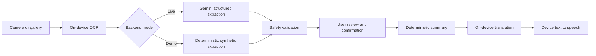

# MediVoice

MediVoice is an accessibility-focused Android application that turns text from prescriptions and medicine labels into user-confirmed, simplified, translated, spoken instructions.

> MediVoice helps explain information written on medicine labels or prescriptions. It does not replace advice from a doctor or pharmacist.

## Problem and solution

Prescription handwriting, small medicine-label text, medical abbreviations, and English-only instructions can prevent patients and caregivers from understanding what was written. MediVoice provides this guarded workflow:



The app never diagnoses, prescribes, validates medical correctness, or fills missing instructions.

## MVP features

- Prescription and medicine-strip scan modes
- Camera and gallery image input with crop/rotate preview
- On-device Latin-script OCR
- Multiple-medicine structured extraction through a minimal FastAPI proxy
- Mandatory review, editing, uncertainty highlighting, and acknowledgement
- Deterministic simplified English summaries
- English, Hindi, and Telugu output
- Device text-to-speech with play, stop, and replay
- Typed safe error states and no scan history

## Architecture

`app/` contains Flutter presentation, workflow state, models, and device services. `backend/` contains the stateless Gemini proxy. The image never leaves the device; only OCR text is sent to the backend. See [docs/ARCHITECTURE.md](docs/ARCHITECTURE.md).

## Prerequisites

- Flutter 3.47 stable with its bundled Dart SDK
- Android Studio and Android SDK 36 (target SDK remains 35)
- Python 3.12
- A Gemini Developer API key only when running live mode
- A physical Android device is strongly recommended for ML Kit and TTS testing

## Run without Gemini

Mock mode is explicit and safe by default in `.env.example`. It accepts only the bundled synthetic demo texts, uses the normal API response schema, and still applies deterministic strip-mode safety. Unknown text fails closed with `502`; the server never silently substitutes mock data while live mode is selected.

```bash
cp .env.example .env
python3.12 -m venv .venv
source .venv/bin/activate
pip install -r backend/requirements.txt -r backend/requirements-dev.txt
uvicorn backend.app.main:app --reload --env-file .env
```

The copied file contains `DEMO_MODE=true` and an empty `GEMINI_API_KEY`. Verify the backend with:

```bash
curl http://127.0.0.1:8000/healthz
```

In another terminal, run the Android app against the local backend:

```bash
cd app
flutter pub get
flutter run \
  --dart-define=DEMO_MODE=true \
  --dart-define=API_BASE_URL=http://10.0.2.2:8000
```

Tap **Try synthetic demo** to bypass camera/OCR with bundled synthetic OCR text, or photograph text matching a supported demo fixture to exercise on-device OCR first. Supported patterns are `clear_single.txt`, `multiple_medicines.txt`, `three_medicines.txt`, `ambiguous_dose.txt`, `medicine_strip_missing_dose.txt`, and `strip_packaging_only.txt`; the last two require medicine-strip mode. Both paths continue through the real API client, safety validation, confirmation, summary, on-device translation, and device TTS. Local HTTP is enabled only in the Android debug manifest.

For a physical device connected to the same network, replace `10.0.2.2` with the development computer's reachable LAN address. Hindi and Telugu may download their ML Kit models on first use; TTS requires the corresponding installed device voice.

## Switch to live Gemini later

No Dart or Python code change is required:

1. Open the untracked `.env` and set `DEMO_MODE=false`.
2. Set `GEMINI_API_KEY` to the real key and keep or change `GEMINI_MODEL=gemini-3.8-flash`.
3. Restart FastAPI so settings are reloaded.
4. Start Flutter without demo mode:

   ```bash
   cd app
   flutter run \
     --dart-define=DEMO_MODE=false \
     --dart-define=API_BASE_URL=http://10.0.2.2:8000
   ```

5. Perform the deferred live-provider and physical-device checks in [docs/TESTING.md](docs/TESTING.md).

When deployed later, use the Cloud Run HTTPS URL as `API_BASE_URL` and inject `GEMINI_API_KEY` into the backend only. Never put the Gemini key in Flutter code or a `--dart-define`.

## Deferred Cloud Run work

For later live verification, build `backend/Dockerfile`, deploy it as one unauthenticated judged-prototype service, and inject `GEMINI_API_KEY` from Secret Manager. Set a maximum instance count and Gemini project quota. Rotate or revoke the key after the event. The public endpoint is not production authentication.

## Tests

```bash
python -m pytest backend
cd app && dart format --set-exit-if-changed . && flutter analyze && flutter test
```

Platform plugins also require the real-device checks in [docs/TESTING.md](docs/TESTING.md).

## Documentation

- [Product specification](docs/PROJECT_SPEC.md)
- [Architecture](docs/ARCHITECTURE.md)
- [API contract](docs/API_CONTRACT.md)
- [Data schema](docs/DATA_SCHEMA.md)
- [Safety](docs/SAFETY.md)
- [Testing](docs/TESTING.md)
- [Limitations](docs/LIMITATIONS.md)

## Future improvements

Possible post-MVP work includes authenticated backend access, broader OCR scripts, full interface localization, encrypted opt-in history, and trusted medicine-reference data. None should weaken the confirmation flow.
