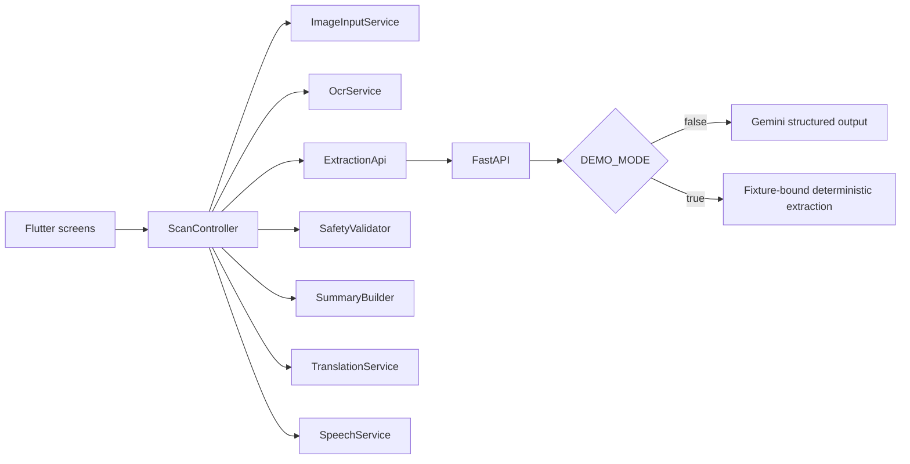

# Architecture

## Components

Flutter widgets render immutable model values and forward user actions to one `ScanController`. The controller owns the active image path, OCR text, original extraction, editable result, acknowledgement state, selected language, translation, and typed error. `provider` injects the controller and service interfaces. Navigation uses Flutter `Navigator` because the flow is short and linear.

## Data flow

1. `ImageInputService` obtains a temporary camera/gallery file and opens the native cropper.
2. `OcrService` validates the decoded image, warns on low resolution, and runs Latin ML Kit OCR.
3. `ExtractionApi` sends only OCR text and mode to FastAPI.
4. FastAPI selects one explicit extraction service. Live mode wraps OCR as untrusted data and requests schema-constrained Gemini output. Demo mode recognizes only bundled synthetic fixture text and fails closed for other input.
5. `SafetyValidator` identifies blocking and acknowledgement conditions.
6. The user edits and confirms the result.
7. `SummaryBuilder` creates English text without adding medical meaning.
8. `TranslationService` downloads and uses the selected ML Kit model.
9. `SpeechService` speaks the final verified text when the locale is installed.

## State and lifecycle

`ScanController` moves through `idle`, `imageSelected`, `processingOcr`, `processingExtraction`, `awaitingConfirmation`, `preparingResult`, `ready`, and `failure`. Retry reuses the in-memory image/OCR text at the failed stage. New Scan stops speech, clears all state, and returns home. Services with native resources expose `dispose` or `close`.

## Backend and deployment

The backend exposes `/healthz` and `/api/v1/extractions`, stores nothing, and logs only request ID, mode, counts, duration, and error code. `DEMO_MODE=false` preserves the production Gemini path and returns a safe 503 when no key is configured. `DEMO_MODE=true` does not initialize or call Gemini. Cloud Run deployment remains deferred; production requires authenticated access or app attestation.

## Error handling

Exceptions terminate at service boundaries and become `AppError`. Empty OCR or invalid model output never reaches confirmation. Translation failures retain verified English. TTS failures retain visible text. Raw provider errors appear only in debug causes and never in release UI.

## Privacy

Images remain in OS/application temporary storage. OCR text is sent to the backend but is not logged or persisted by MediVoice. The backend forwards it to Gemini only in live mode; demo mode uses fixture-bound deterministic extraction. No identity, history, database, or analytics exists in the MVP.
