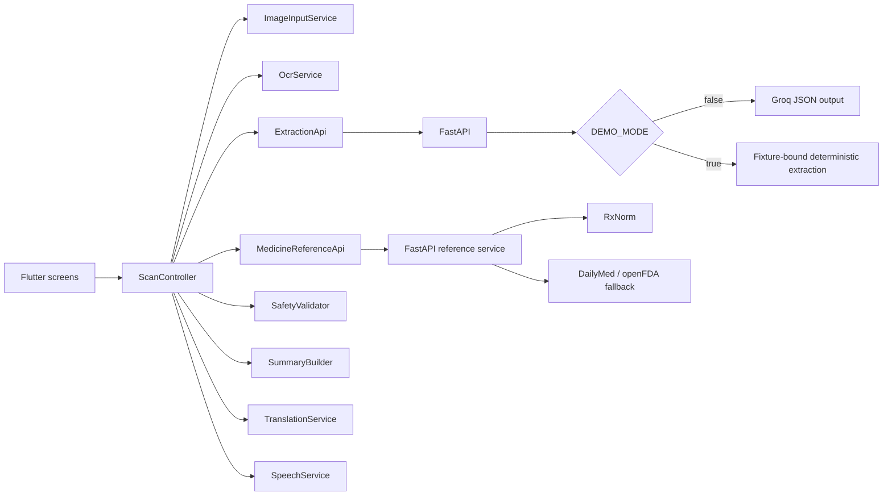

# Architecture

## Components

Flutter widgets render immutable model values and forward user actions to one `ScanController`. The controller owns the active image path, OCR text, original extraction, editable result, acknowledgement state, selected language, translation, and typed error. `provider` injects the controller and service interfaces. Navigation uses Flutter `Navigator` because the flow is short and linear.

## Data flow

1. `ImageInputService` obtains a temporary camera/gallery file and opens the native cropper.
2. `OcrService` validates the decoded image, warns on low resolution, and runs Latin ML Kit OCR.
3. `ExtractionApi` sends only OCR text and mode to FastAPI.
4. FastAPI selects one explicit extraction service. Live mode numbers OCR lines and mechanically groups possible medicine-anchor, dose, food/timing, and duration rows without assigning them. The prompt tells Groq to use explicit numbering and equal-length relative order as evidence for fragmented columns, while leaving ambiguous assignments null. It first sends the untrusted, delimited OCR prompt to Groq's OpenAI-compatible Chat Completions endpoint in strict JSON Schema mode. The provider envelope may contain zero medicines; after Pydantic validation, zero substantive items fail deterministically and never become a success response. Only Groq's explicit structured-output validation error triggers one JSON-object fallback, followed by the same Pydantic and deterministic safety validation. SDK retries are disabled, so a 429 immediately returns a temporary rate-limit error with `Retry-After` when available. It sends no tools or functions. Demo mode recognizes only bundled synthetic fixture text and fails closed for other input.
5. Only after user confirmation, `MedicineReferenceApi` sends medicine names and uncertainty flags to a separate FastAPI route. `MedicineReferenceService` normalizes reliable names with RxNorm, reads concise supported label facts from DailyMed, and uses openFDA drug labels only as fallback. Uncertain and ambiguous identities fail closed. A bounded in-memory cache stores only public medicine-reference results.
6. `SummaryBuilder` keeps the doctor's scanned instructions separate from general reference facts, then creates the concise verified text used by on-device translation and TTS. Reference-service failure never changes or blocks the prescription path.
7. `SafetyValidator` identifies blocking and acknowledgement conditions and derives a categorical confidence label from measurable state only. High means complete, certain core instructions with no warnings; Medium means optional information is missing or only non-critical information is uncertain; Low means a critical field is missing/uncertain, a warning exists, or the deterministic suspicious-dose rule fires. No percentage is shown.
8. The app shows one quick multi-medicine review. Confident fields can be accepted together with **Looks correct**. **Review unclear details** exposes only highlighted fields when any exist; full correction remains an optional user action when nothing was marked unclear.
9. `SummaryBuilder` creates short, deterministic English explanations from confirmed prescription facts and separately retrieved reference facts. It never invents a prescribed purpose, side effect, or treatment instruction.
10. `TranslationService` translates the explanation as prose with the selected ML Kit model. Medicine names, strengths, and numeric facts are protected and restored exactly; a protection failure fails closed to the checked English explanation.
11. `SpeechService` speaks the selected localized explanation at a slower rate using `en-IN`, `hi-IN`, or `te-IN` when that device voice is installed.

## State and lifecycle

`ScanController` moves through `idle`, `imageSelected`, `processingOcr`, `processingExtraction`, `awaitingConfirmation`, `preparingResult`, `ready`, and `failure`. OCR proceeds directly into extraction. Debug builds add a developer-only action on the medicine review screen that opens the in-memory OCR viewer without changing workflow state; the action and viewer are gated by `kDebugMode` and are unreachable in release builds. Retry reuses the in-memory image/OCR text at the failed stage. New Scan stops speech, clears all state, and returns home. Services with native resources expose `dispose` or `close`.

## Backend and deployment

The backend exposes `/healthz`, `/api/v1/extractions`, and `/api/v1/medicine-references` and stores no patient data. Normal logs contain only request ID, mode, counts, duration, and error code. Development-only provider diagnostics retain sanitized Groq HTTP 400 metadata or Pydantic validation path/type; they exclude keys, OCR/request text, generated prescription content, and `failed_generation`. `DEMO_MODE=false` selects `GroqExtractionService` and returns a safe 503 when no key is configured. `DEMO_MODE=true` selects only `MockExtractionService` and never initializes or calls Groq. Cloud Run deployment remains deferred; production requires authenticated access or app attestation.

## Error handling

Exceptions terminate at service boundaries and become `AppError`. Empty OCR or invalid model output never reaches confirmation. Translation failures retain verified English. TTS failures retain visible text. Provider diagnostics are sanitized at the backend boundary and never appear in release UI.

## Privacy

Reference lookup never receives the prescription image, full OCR text, patient name, diagnosis, strength, dose, timing, or duration. Only a medicine name and uncertainty flag—or an RxCUI between public reference APIs—is transmitted. Application logs contain counts and request IDs, not medicine names or returned clinical text.

Images remain in OS/application temporary storage. OCR text is sent to the backend but is not logged or persisted by MediVoice. The backend forwards it to Groq only in live mode; demo mode uses fixture-bound deterministic extraction. No identity, history, database, or analytics exists in the MVP.
